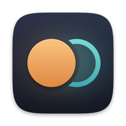
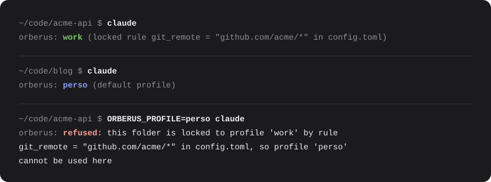
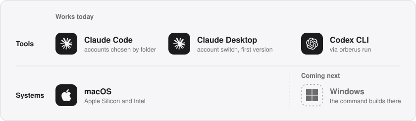
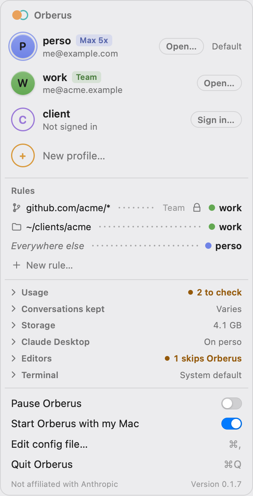
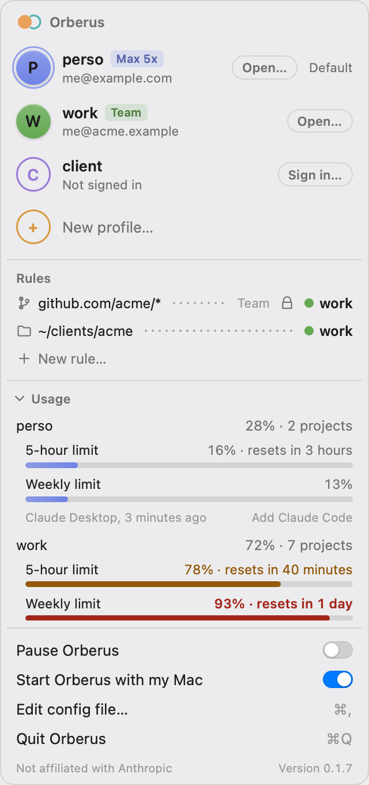

<div align="center">
  
  <h1>Orberus</h1>
  <p><b>The right account for each folder. Automatically.</b></p>
  <p>Several Claude Code accounts on one Mac, picked by the folder you are in.<br>Codex is next.</p>
  <p>
    <a href="https://github.com/Tz-dev0/orberus/releases"></a>
    <a href="LICENSE"></a>
    
  </p>
</div>

<p align="center">
  
</p>

`orberus` keeps several accounts on one Mac (work, personal, client) and picks
the account from the folder you are in. You keep typing `claude`: a company
repository always opens with the company account, a side project with yours,
and a locked rule refuses the wrong one.

> Not affiliated with Anthropic, OpenAI, Apple or Microsoft. Claude is a
> trademark of Anthropic.
>
> Early version, developed and tested on macOS. It is meant for people who
> hold several legitimate, paid accounts. It does not switch accounts to get
> around usage limits.

## Where it runs

<p align="center">
  <picture>
    <source media="(prefers-color-scheme: dark)" srcset="docs/images/platforms-dark.svg">
    
  </picture>
</p>

A solid tile works today; a dashed one is planned, with no date yet. The
logos belong to their owners and only say what Orberus works with.

- **Claude Code on macOS** is what Orberus handles now.
- **Codex** is the next tool: the same profiles and the same rules would pick
  its account too. Nothing of it is in the releases yet.
- **Claude Desktop**: Orberus already reads the plan usage it notes, for the
  limits. Giving each profile its own Claude Desktop account is planned.
- **Windows**: the command builds and passes its tests there, but it was
  never tried in front of a real Claude Code. Not supported yet.

## Features

- **Automatic choice**: you keep typing `claude`. The account comes from a
  rule on the folder or on the git remote, so there is no switch command to
  forget.
- **Guard rail**: a locked rule wins over everything, and Claude Code does not
  start with another account in that folder.
- **Team rules**: a company can hand out a `team.toml`; its rules are checked
  before yours.
- **Separate logins**: each profile has its own Claude Code folder and its own
  login. Your existing `~/.claude` can be one of them, left untouched.
- **Usage by project**: see which projects used each account, and which of
  them no rule covers. Work done on the wrong account shows up there.
- **Disk space and history**: see what each profile takes, choose how long
  conversations are kept, and move the biggest ones to the Trash.
- **Limits at a glance**: the 5-hour and weekly limits of each account, side
  by side.
- **Menu bar app** (optional): the same profiles and rules, one click away.

<p align="center">
  <picture>
    <source media="(prefers-color-scheme: dark)" srcset="docs/images/app-dark.png">
    
  </picture>
  &nbsp;&nbsp;
  <picture>
    <source media="(prefers-color-scheme: dark)" srcset="docs/images/usage-dark.png">
    
  </picture>
</p>
<p align="center"><sub>The menu bar app, drawn from its real interface with made-up accounts.</sub></p>

## Quick start

Orberus needs macOS (Apple Silicon or Intel) and
[Claude Code](https://claude.com/claude-code) already
installed.

**Install**

```sh
mkdir -p ~/.orberus/bin
curl -fsSL https://github.com/Tz-dev0/orberus/releases/latest/download/orberus-cli-macos-universal.tar.gz \
  | tar -xz -C ~/.orberus/bin --strip-components 1 orberus-cli-macos-universal/orberus
~/.orberus/bin/orberus setup
```

`setup` installs the `claude` shim next to `orberus` and offers to add that
folder to your `PATH`. Open a new terminal afterwards. Other ways to install,
and how to update or uninstall, are in [docs/installation.md](docs/installation.md).

**Create your profiles**

```sh
orberus add perso --native   # your current login, ~/.claude, kept as it is
orberus add work             # a second, empty profile
orberus run --profile work   # start Claude Code in it once, then /login
```

**Send a repository to a profile**

```sh
orberus rule add --git-remote "github.com/acme/*" --profile work --locked
```

From then on, just type `claude`.

Most commands ask for what you leave out, so `orberus add` and
`orberus rule add` alone also work: they guide you step by step.

## How a profile is chosen

The first of these that applies wins:

1. a **locked rule**. It also refuses an explicit choice of another profile
2. an **explicit choice**: `orberus run --profile x`, or `ORBERUS_PROFILE=x claude`
3. a **`.orberus-profile` file** in the folder or a parent (`orberus use x`)
4. the **first matching rule**, team rules before your own
5. the **default profile**

`orberus status` tells you which one applies where you are, and why:

```text
$ orberus status
  Profile  work
  Account  me@acme.example (Team)
  Why      locked rule git_remote = "github.com/acme/*" in config.toml
  Config   ~/.orberus/profiles/work
  Claude   /opt/homebrew/bin/claude
```

With no config at all, `claude` runs exactly as if nothing was installed.
Rules, the config files and team rules are described in
[docs/rules.md](docs/rules.md).

## Commands

| Command | What it does |
|---|---|
| `orberus` | Profile used in this folder, then the list of commands |
| `orberus setup` | Install the `claude` shim and put it in your `PATH` |
| `orberus add [name]` | Create a profile (`--native` reuses `~/.claude`) |
| `orberus list` | Profiles, the account logged in to each, the default |
| `orberus status` | Which profile applies here, and why |
| `orberus use [name]` | Pin the current folder to a profile |
| `orberus default [name]` | Profile used when no rule applies |
| `orberus run [-p name] [-- args]` | Start Claude Code, optionally forcing a profile |
| `orberus rule add`, `list`, `remove` | Manage the rules |
| `orberus usage [name]` | Which projects used each account, checked against your rules; `-c` for the heaviest conversations |
| `orberus disk` | Disk space of each profile. Deletes nothing |
| `orberus limits [on\|off] [name]` | The 5-hour and weekly limits of each account, as Claude Desktop and Claude Code note them |
| `orberus retention [name] [days]` | How long each profile keeps its conversations |
| `orberus clean [name]` | Biggest conversations of a profile; move some to the Trash |
| `orberus remove [name]` | Remove a profile and your rules that point to it |
| `orberus doctor` | Check the installation |
| `orberus uninstall` | Remove Orberus from this Mac. Profiles are kept unless you add `--purge` |

Every command, with its options and an example of its output, is in
[docs/commands.md](docs/commands.md).

## Features in detail

The examples below are shortened.

### Profiles

```text
$ orberus list
┌─────────┬─────────────────┬────────┬─────────────────────────────────┬───────┬─────────┬──────┐
│ Profile │ Account         │ Plan   │ Config folder                   │ Rules │ Default │ Here │
├─────────┼─────────────────┼────────┼─────────────────────────────────┼───────┼─────────┼──────┤
│ perso   │ me@example.com  │ Max 5x │ ~/.claude (Claude Code default) │       │ ●       │ ✓    │
│ work    │ me@acme.example │ Team   │ ~/.orberus/profiles/work        │ 1     │         │      │
└─────────┴─────────────────┴────────┴─────────────────────────────────┴───────┴─────────┴──────┘
  Default: used when no rule applies.   Here: used in this folder.
```

A profile is a Claude Code config folder with its own login, settings and
history. The profile created with `--native` is your existing `~/.claude`.

### Usage by project

`orberus usage` shows where each account was used over the last 7 days, and
flags the projects your rules do not send there. Here a personal blog ran on
the work account:

```text
$ orberus usage work
work  me@acme.example, last 7 days
┌───────┬─────────────────┬─────────┬────────────────────────────────────────────────┐
│ Share │ Project         │ Answers │ Today's rules                                  │
├───────┼─────────────────┼─────────┼────────────────────────────────────────────────┤
│ 63%   │ ~/code/acme-api │ 942     │ ✓ locked rule git_remote = "github.com/acme/*" │
│ 26%   │ ~/code/blog     │ 402     │ would use perso today (default profile)        │
│ 9%    │ ~/code/acme-web │ 148     │ ✓ locked rule git_remote = "github.com/acme/*" │
└───────┴─────────────────┴─────────┴────────────────────────────────────────────────┘
! 26% came from 1 project(s) where `claude` would use another profile today.
```

`orberus usage --conversations` lists the conversations instead, with how
many tokens each one sends again at every answer: the long ones are where a
`/compact` or a fresh conversation saves the most.

The share is an estimate from the conversations kept on this Mac. It is not
what your plan counts against its limits.

### Disk space

```text
$ orberus disk
┌─────────┬────────┬──────────┬──────────────┬─────────────────┬────────┐
│ Profile │ Total  │ Sessions │ File history │ Plugins, skills │ Other  │
├─────────┼────────┼──────────┼──────────────┼─────────────────┼────────┤
│ perso   │ 28 MB  │ 28 MB    │ 0 B          │ 0 B             │ 4.1 KB │
│ work    │ 252 MB │ 239 MB   │ 0 B          │ 13 MB           │ 4.1 KB │
└─────────┴────────┴──────────┴──────────────┴─────────────────┴────────┘
  All profiles: 280 MB
  Nothing is deleted by this command.
```

### Cleaning up conversations

`orberus clean` lists a profile's conversations, biggest first. Nothing moves
until you pick some, and what you pick goes to the macOS Trash with a note
that says where to put it back.

```text
$ orberus clean work
┌───┬────────┬─────────────┬─────────────────┬────────────────────────────┬──────────┐
│ # │ Size   │ Last used   │ Folder          │ Title                      │ Id       │
├───┼────────┼─────────────┼─────────────────┼────────────────────────────┼──────────┤
│ 1 │ 168 MB │ 4 days ago  │ ~/code/acme-api │ Payment retries            │ 3f2a9c1e │
│ 2 │ 63 MB  │ 2 days ago  │ ~/code/acme-api │ Migrate the invoices table │ 7b8d0e2f │
│ 3 │ 8.4 MB │ 16 days ago │ ~/code/acme-api │ Fix flaky login test       │ a1c4e5f6 │
└───┴────────┴─────────────┴─────────────────┴────────────────────────────┴──────────┘
  3 conversation(s), 239 MB in all
  Nothing was changed.
```

### How long conversations are kept

Claude Code deletes conversations after 30 days by default, without a
message. `orberus retention` shows the setting of each profile and changes it:

```text
$ orberus retention work 365
✓ Profile 'work' keeps its conversations 1 year
```

### Menu bar app

A small app that lives in the menu bar: your profiles and who is logged in to
each, the rules, the limits and the usage by project, the disk space, and a
button to open Claude Code in a profile. It speaks English and French.
It reads and writes the same config as the CLI and is optional. See
[docs/app.md](docs/app.md).

## Safety

- The shim only chooses a config folder, then hands over to the real Claude
  Code. It does not read your conversations or your credentials, and it makes
  no network request.
- If the config cannot be read, or a locked rule forbids the profile you asked
  for, Claude Code does not start. It never falls back to another account.
- `usage`, `disk`, `list`, `status` and `doctor` change nothing. `usage` reads
  only the token counts and the folder of each answer, and the title of a
  conversation, never what was said.
- `clean` moves conversations to the Trash and refuses one that changed in the
  last hour, since it may still be open. It never touches `memory/` folders.
- `remove` keeps the profile's folder, so its login and history stay on disk.
  Only `remove --purge` deletes them, and it is refused for `~/.claude`.
- `uninstall` removes the tool and keeps your profiles. Nothing ever deletes
  `~/.claude`.

Known limits are listed in [docs/troubleshooting.md](docs/troubleshooting.md#known-limits).
To report a vulnerability, see [SECURITY.md](SECURITY.md).

## Documentation

- [Installation](docs/installation.md): install, update, uninstall, build from source
- [Rules and configuration](docs/rules.md): rule types, `config.toml`, team rules
- [Commands](docs/commands.md): every command and its options
- [Menu bar app](docs/app.md)
- [How it works](docs/how-it-works.md)
- [Troubleshooting](docs/troubleshooting.md): known limits and common problems

## Get help

First run `orberus doctor` and read what it says: it checks the shim, your
`PATH`, the config files and the rules, and tells you how to fix what is wrong.

Then read [Troubleshooting](docs/troubleshooting.md). If the problem is still
there, [open an issue](https://github.com/Tz-dev0/orberus/issues) with
the output of `orberus doctor` and `orberus status`.

## Contributing

Bug reports, ideas and pull requests are welcome. See
[CONTRIBUTING.md](CONTRIBUTING.md) for how to build and test the project.

## License

[MIT](LICENSE).
